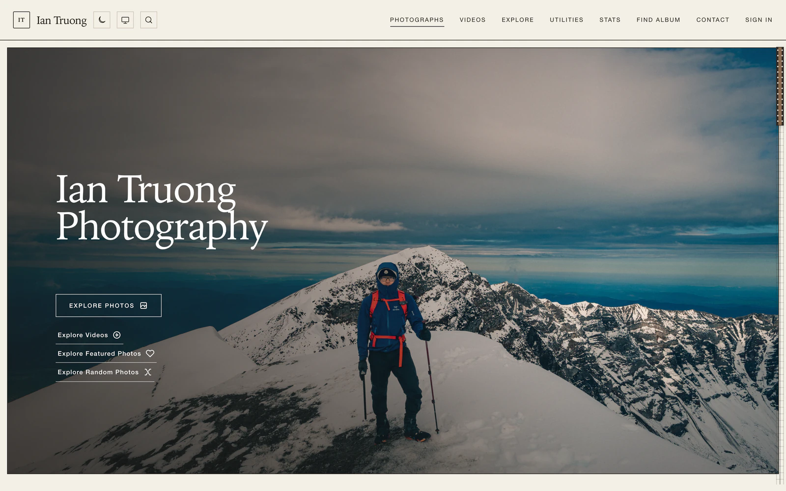
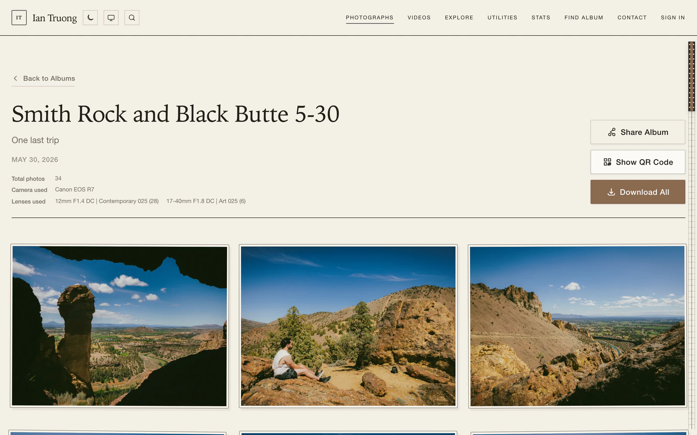
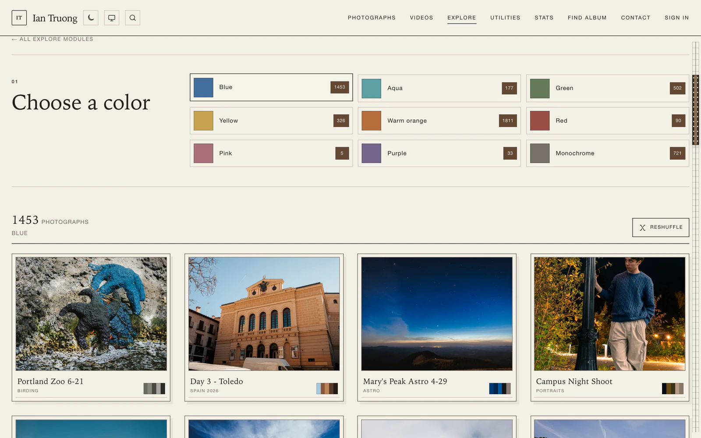
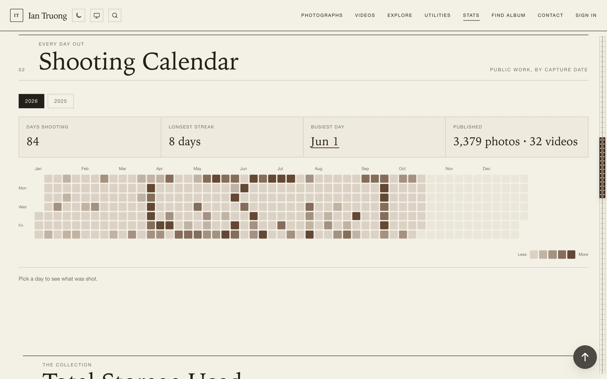
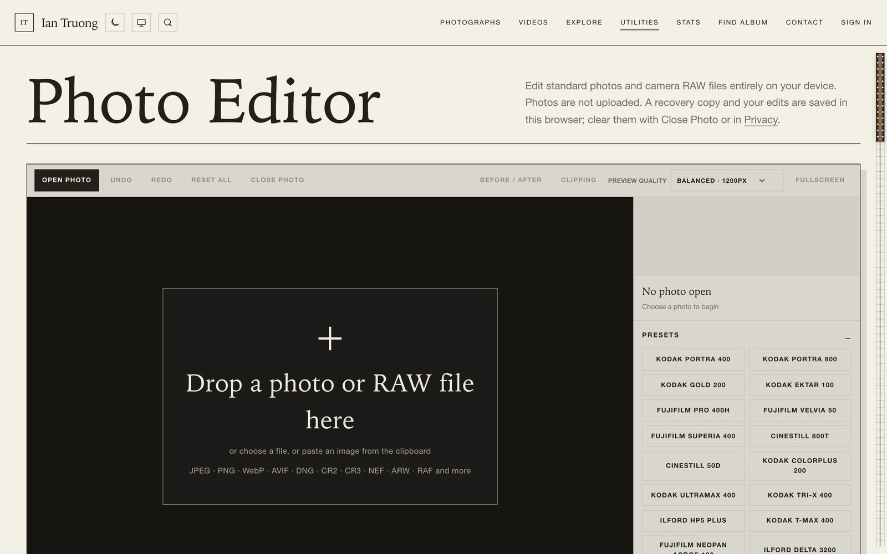
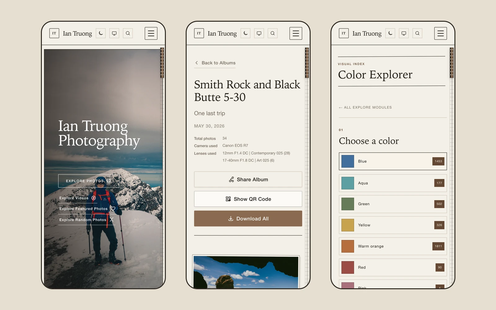

<div align="center">

# Ian Truong Photography

Source code for [iantruongphotography.com](https://iantruongphotography.com): a photography portfolio, private client galleries and an admin portal, running serverless on AWS.

[Live site](https://iantruongphotography.com) · [Architecture board](https://miro.com/app/board/uXjVEYlOMic=/) · [Ops docs](ops/README.md)


</div>

---

The frontend is a React single-page app served through CloudFront. The API is a set of Python Lambda functions behind API Gateway, with data in DynamoDB and media in S3. Image previews, video transcoding, ZIP archives, backups and cache refreshes run in the background on SQS queues. Pushes to `main` are tested, deployed through GitHub Actions and smoke-tested against production.

| | |
|---|---|
| 52 | Lambda functions (Python 3.12, plus a Node.js image preview worker) |
| 11 | DynamoDB tables |
| 12 | SQS queues |
| 2 | CloudFront distributions (app and API, media) |
| ~290 | test files, with an 80% coverage minimum on frontend, backend, worker and ops code |

## Screenshots

<p align="center">
  
  <br>
  <sub><b>Home</b> · full-bleed hero with quick links into photos, videos, featured and random picks</sub>
</p>

<table>
  <tr>
    <td width="50%" valign="top">
      
      <p align="center"><sub><b>Album with progressive previews</b></sub></p>
    </td>
    <td width="50%" valign="top">
      
      <p align="center"><sub><b>3D living museum</b> (react-three-fiber)</sub></p>
    </td>
  </tr>
  <tr>
    <td width="50%" valign="top">
      
      <p align="center"><sub><b>Explore by color</b></sub></p>
    </td>
    <td width="50%" valign="top">
      
      <p align="center"><sub><b>Stats</b> · shooting calendar heatmap</sub></p>
    </td>
  </tr>
  <tr>
    <td width="50%" valign="top">
      
      <p align="center"><sub><b>In-browser RAW editor</b> (LibRaw → WebAssembly)</sub></p>
    </td>
    <td width="50%" valign="top">
      
      <p align="center"><sub><b>Mobile</b> · home, album and color explorer</sub></p>
    </td>
  </tr>
</table>


## Features

**Visitors**

- Photo and video albums with blurhash placeholders, responsive WebP previews from 640 to 1920 px, and adaptive HLS video
- Explore section: a walkable 3D gallery (react-three-fiber), browsing by color, lens, exposure, time of day and season, and a "Guess the Settings" game
- Search, a stats page with a shooting-day calendar, random and featured photos, and a TV slideshow mode with Chromecast support
- Print store, and a contact form protected by Cloudflare Turnstile
- Installable PWA, and link previews for shared albums

**Clients**

- Cognito sign-in with optional TOTP two-factor authentication and a dashboard of owned galleries
- Unlisted share links; invalid or revoked links return the same response as a missing album
- Full-resolution downloads through CloudFront signed cookies or short-lived presigned URLs, and full-album ZIP downloads
- Before-and-after comparison against the original file

**Admin**

- Direct browser-to-S3 uploads, album management, gallery ordering, scheduled publishing and a Recently Deleted bin with automatic purge
- Videos page hero reel generated server-side with ffmpeg
- Dashboards for AWS cost (including per-album storage and bandwidth), analytics with Core Web Vitals, GitHub activity, site health and the audit log

**Tools**

- In-browser RAW editor: LibRaw compiled to WebAssembly with Emscripten, decoding in a Web Worker, with presets, adjustments and session recovery in IndexedDB

## Architecture

The [Miro architecture board](https://miro.com/app/board/uXjVEYlOMic=/) has three diagrams: the request path, the background jobs, and delivery and operations.

### Requests

- Browsers only connect to CloudFront. The app calls the API at `/api` on the same domain.
- CloudFront adds a secret origin header to API requests. Every Lambda checks it ([`front_door.py`](backend/functions/front_door.py)) and rejects requests without it. The default `execute-api` endpoint is disabled.
- AWS WAF sits in front of both CloudFront distributions, with managed rule groups and per-IP rate limits on the API, the Explore endpoints and the media CDN.
- API Gateway validates the Cognito token, and each handler checks album ownership or `Admins` group membership.

### Media

- Uploads go from the browser straight to S3 using presigned URLs.
- Public previews and video are served by the media CloudFront distribution from a private S3 bucket.
- Private originals are served with CloudFront signed cookies. S3 Block Public Access, origin access control and object visibility tags keep non-public files off the CDN.

### Background jobs

- Preview generation (Node.js and Sharp), MediaConvert video transcoding, ZIP building, cache invalidation, hover-preview manifests, Google Drive backup and original-file comparisons run from SQS queues, DynamoDB Streams, S3 events or EventBridge schedules.
- Queues retry failed jobs and move them to dead-letter queues after repeated failures.

### Monitoring and alerts

- CloudWatch alarms that send email: server errors on the site, API or media CDN; background jobs in dead-letter queues; stale or failed backups; root account activity. AWS Budgets sends an email when monthly spend goes over its limit.
- About 25 other alarms are recorded on dashboards without sending email.
- CloudTrail, AWS Config, GuardDuty, Security Hub and IAM Access Analyzer cover the account. AWS Backup takes daily backups of the main DynamoDB tables and keeps them for 35 days.

### Cost controls

- Per-route API Gateway throttles, per-IP WAF rate limits, reserved Lambda concurrency, upload size limits and a monthly AWS Budgets alert.

## Tech stack

| Area | Technologies |
|---|---|
| Frontend | React 19, React Router 8, Vite 7, Tailwind CSS 4, Three.js with react-three-fiber and drei, Framer Motion, hls.js, blurhash, exifr, web-vitals |
| In-browser imaging | LibRaw compiled to WebAssembly with Emscripten, Web Workers, IndexedDB |
| Backend | Python 3.12 on Lambda (AWS SAM), boto3, PyJWT, Pillow, Google API client; Node.js 22 and Sharp for previews; ffmpeg for the hero reel |
| AWS | API Gateway, Lambda, Cognito, DynamoDB, S3, CloudFront and CloudFront Functions, WAF, Route 53, ACM, SQS, EventBridge, MediaConvert, SSM Parameter Store, Secrets Manager, KMS |
| Monitoring and security | CloudWatch, X-Ray, SNS, CloudTrail, AWS Config, GuardDuty, Security Hub, IAM Access Analyzer, AWS Backup, AWS Budgets |
| Third-party services | Cloudflare Turnstile, Resend, Google Drive, GitHub API, Fotomoto, Google Cast |
| Testing and CI | Vitest, Testing Library, Playwright, Python `unittest` with moto and coverage.py, ESLint, cfn-lint, actionlint, zizmor, CodeQL, pip-audit, npm audit, CycloneDX SBOMs, GitHub artifact attestations |

## Build and release

- GitHub Actions authenticates to AWS with OIDC. Only the `main` branch of this repository can assume the deploy roles, and no AWS keys are stored in GitHub.
- One role plans the CloudFormation change set and a separate role executes it. A release guard checks the plan and stops the release on unlisted resource removals, replacements or changes to protected resources.
- Each Lambda is packaged from an explicit list of source files ([`backend/Makefile`](backend/Makefile)), and build output is scanned for credentials.
- Release artifacts get checksums, CycloneDX SBOMs and signed build provenance.
- GitHub Actions are pinned to commit SHAs. Pull requests run CodeQL, dependency review and a scan of the full git history for secrets.
- Routes are lazy-loaded, large libraries (Three.js, hls.js, auth, animation, imaging) are split into separate bundles, and public API responses are cached at the edge.
- A weekly workflow checks all nine CloudFormation stacks for drift.

## Running locally

Requires Node.js 24 (see [`.node-version`](.node-version)) and Python 3.12.

```bash
npm ci
cp .env.example .env   # public, non-secret values only
npm run dev
```

The dev server does not proxy `/api` by default, so UI work does not touch live data. Setting `VITE_DEV_PROXY_PROD=1` in `.env` proxies `/api` and private media to production; admin actions then change real data.

`.env`, credential files, media and build output are git-ignored.

## Tests

The same checks CI runs before a release:

```bash
# Frontend: lint, tests with coverage, production build
npm run verify:ci

# Backend (Python 3.12)
python3 -m pip install -r backend/requirements-dev.txt
(cd backend && PYTHONPATH=functions python3 -m coverage run --rcfile=.coveragerc -m unittest discover -s tests -p 'test_*.py')

# Image preview worker
npm --prefix backend/preview_worker ci
npm --prefix backend/preview_worker run test:coverage

# Infrastructure and ops tooling
python3 -m coverage run --rcfile=ops/.coveragerc -m unittest discover -s ops/tests -p 'test_*.py'

# CloudFormation lint and SAM build
bash ops/validate_infrastructure.sh --build
```

Also available: Playwright browser checks (`npm run test:browser`, `npm run test:browser:visitors`) and a WebAssembly RAW decoder test (`npm run test:raw-decoder`).

## Deployment

`main` is the only deployment branch. Each push to `main`:

1. Runs the test and security suite.
2. Builds the frontend and backend artifacts and records checksums, SBOMs and build provenance.
3. Gets temporary AWS credentials through GitHub OIDC.
4. Plans the backend change set, checks it against the release guard, then applies it.
5. Uploads the frontend to S3 and invalidates the CloudFront cache.
6. Runs a smoke test against production.

The supporting stacks (WAF, security services, backups, monitoring) are deployed manually and checked for drift weekly. See [`ops/CI_CD.md`](ops/CI_CD.md).

## Repository layout

```text
.
├── src/                 React app: pages, components (including the 3D gallery), RAW editor, hooks, utils, tests
├── public/              Service worker, web manifest, security.txt, open-source license files
├── backend/
│   ├── functions/       Python Lambda handlers and shared helpers
│   ├── preview_worker/  Node.js + Sharp image preview worker
│   ├── tests/           Backend tests
│   ├── Makefile         Source file list for each Lambda build
│   └── template.yaml    Main AWS SAM stack
├── ops/
│   ├── ci/              Release checks, deploy and drift-audit scripts
│   ├── tests/           Infrastructure and ops tooling tests
│   ├── *.yaml           WAF, security, backup, monitoring, DNSSEC and CI stacks
│   └── *.md             Ops docs (start with ops/README.md)
├── scripts/             RAW decoder build, license generator, build helpers
├── tests/browser/       Playwright checks
├── legal/               Third-party license texts bundled into the build
├── .github/workflows/   Pull request, release, manual release and weekly audit workflows
├── index.html           Main app entry
└── print.html           Print store entry
```

## Documentation

| Topic | Document |
|---|---|
| Ops overview and maintenance scripts | [`ops/README.md`](ops/README.md) |
| Release pipeline | [`ops/CI_CD.md`](ops/CI_CD.md) |
| API origin verification and WAF | [`ops/API_FRONT_DOOR.md`](ops/API_FRONT_DOOR.md) |
| Private media and signed downloads | [`ops/PRIVATE_MEDIA.md`](ops/PRIVATE_MEDIA.md) |
| Monitoring and alarms | [`ops/OBSERVABILITY.md`](ops/OBSERVABILITY.md), [`ops/ALARM_REGISTRY.md`](ops/ALARM_REGISTRY.md) |
| AWS account security | [`ops/SECURITY_ACCOUNT_BASELINE.md`](ops/SECURITY_ACCOUNT_BASELINE.md), [`ops/SECURITY_OBSERVABILITY.md`](ops/SECURITY_OBSERVABILITY.md) |
| Maintenance and recovery | [`ops/MAINTENANCE_AND_RECOVERY.md`](ops/MAINTENANCE_AND_RECOVERY.md) |
| Feature notes | [`ops/PHOTO_ORIGINAL_COMPARISONS.md`](ops/PHOTO_ORIGINAL_COMPARISONS.md), [`ops/HOVER_PREVIEW_MANIFESTS.md`](ops/HOVER_PREVIEW_MANIFESTS.md), [`ops/FOTOMOTO_PRINTS.md`](ops/FOTOMOTO_PRINTS.md) |
| Privacy requests | [`ops/PRIVACY_REQUESTS.md`](ops/PRIVACY_REQUESTS.md) |
| Open-source licenses | [`THIRD_PARTY_NOTICES.md`](THIRD_PARTY_NOTICES.md) |

## Security

Report vulnerabilities to the contact in [`security.txt`](public/.well-known/security.txt) instead of opening a public issue.
